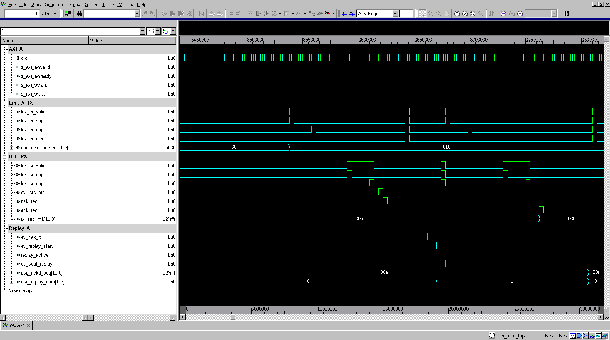
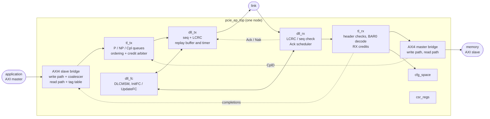
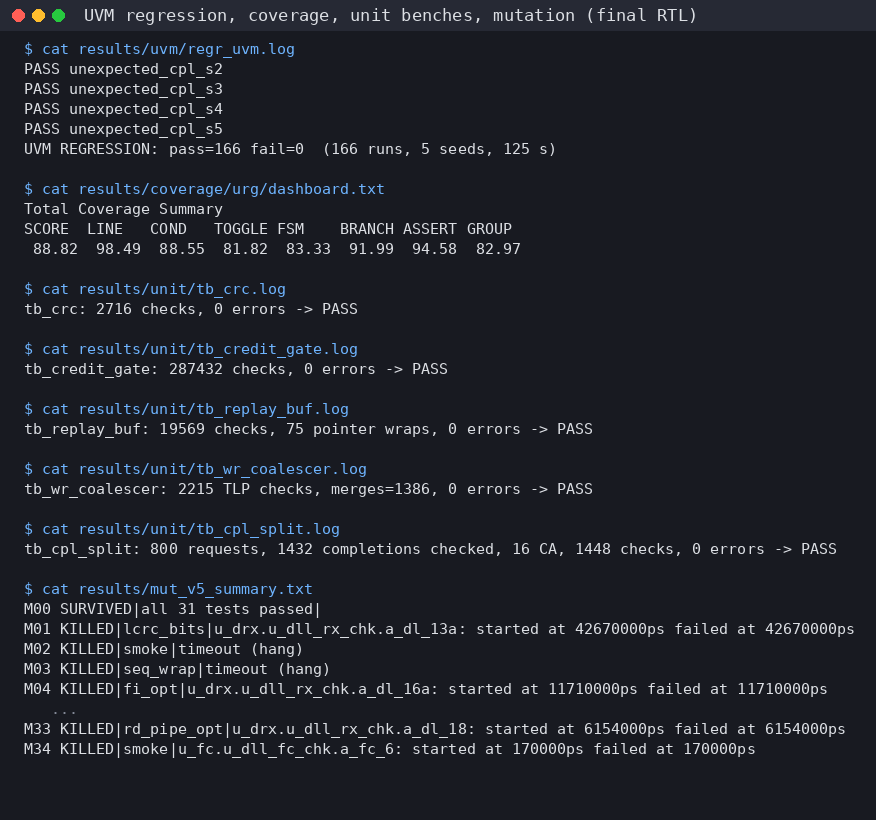

# PCIe Transaction Layer + Data Link Layer Endpoint

This is a PCIe-style endpoint that I wrote in SystemVerilog: the Transaction Layer and the Data Link Layer, with an AXI4 bridge on each side. An AXI write or read on one node turns into TLPs, goes across a link, and comes out as an AXI transaction on the other node. The repo has the RTL, a UVM testbench, synthesis scripts for Design Compiler, and the results of all of it.

It is not a full PCIe core. There is no PHY, no LTSSM and no line coding. The "link" is a 128-bit parallel interface, and in simulation two endpoints are wired back to back through a link model that can corrupt, drop, duplicate or delay frames on purpose. The interesting part of the project is everything above the PHY: sequence numbers, LCRC, Ack/Nak and replay, flow-control credits, ordering rules, completion splitting.



*One replay, start to finish. Node A sends TLP 0x0F, the link model corrupts it, node B sees the LCRC error and sends a Nak, A replays the frame, B accepts it and Acks.*

## What's in the design



**Transaction Layer.** Three transmit queues (posted, non-posted, completion) with an arbiter that enforces the PCIe ordering rules and only releases a TLP when the other side has advertised enough credits. On receive it checks the header, decodes BAR0, answers Type 0 config accesses, and returns Unsupported Request for anything it does not own. Read completions are split at the 64-byte read completion boundary.

**Data Link Layer.** 12-bit sequence numbers, 32-bit LCRC, Ack/Nak DLLPs, a replay buffer with a replay timer and REPLAY_NUM rollover, and the flow-control state machine (InitFC1, InitFC2, UpdateFC).

**AXI bridges.** The slave port is the requester side: AXI writes become MWr, AXI reads become MRd and the completions are reassembled into R beats. The master port is the completer side and drives a memory. INCR bursts only.

**Four optimizations**, each with its own enable bit in a CSR so it can be measured against the baseline in the same build:

| | What it does |
|---|---|
| OP1 | Ack coalescing and an adaptive replay timer |
| OP2 | Early UpdateFC, sent before the peer runs out of credits |
| OP3 | Write coalescing: adjacent small AXI writes are merged into one TLP |
| OP4 | Out-of-order read return across AXI IDs |

Things I left out on purpose: PHY and LTSSM, power states, hot reset, more than one virtual channel, ECRC, MSI, message and I/O TLPs, Type 1 config, AER, AXI WRAP and FIXED bursts, and place and route.

## Results

The full numbers, each with the report file it came from, are in [docs/results.md](docs/results.md). This is the short version.

### Synthesis

Design Compiler V-2023.12-SP5, FreePDK45 (`gscl45nm`, typical corner), 4.0 ns clock.

| Build | WNS | Violating paths | Area |
|---|---|---|---|
| All optimizations (OPT_EN=1) | 0.00 ns | 0 | 957,449 um² (about 510k gate equivalents) |
| Optimizations removed (OPT_EN=0) | 0.00 ns | 0 | 923,424 um² (about 492k gate equivalents) |

So timing closes at 250 MHz and the four optimizations cost 3.7 % area. Hold is clean with a 0.05 ns skew budget. The critical path runs from the read pointer of the posted queue, through the queue's read mux, into the DLL framing register.

Two things to know before you quote these numbers:

- The five RAMs (replay buffer, RX ring, completion buffer, read buffer, posted buffer) are black boxes in the table above, because the library has no RAM macros. I also ran a build that maps the RAMs to flip-flops (`syn_mem/`), which adds about 200k flops and comes out at 4.14 mm² with **timing not met**: WNS -0.32 ns and 44,682 violating paths. That says more about building 25 KiB of memory out of flops than about the logic, but it is the honest result.
- The clock is ideal. There is no clock tree and no place and route, so these are synthesis estimates, not sign-off.

Power is about 560 mW for one node at 250 MHz, and 95 % of that is the clock pins of roughly 50k flops, because the design has no clock gating. That is the first thing I would fix.

Report excerpts for the black-box build (QoR and critical path, then area, hold and power):

<p> </p>

And for the build with the RAMs as flip-flops, where timing fails:

<p></p>

### Verification

| | Result |
|---|---|
| UVM regression | 166 of 166 runs pass (33 tests, 5 seeds each, plus a sequence-wrap test) |
| Unit benches | 5 of 5 pass (CRC against Python's zlib, credit gate, replay buffer, write coalescer, completion split) |
| Mutation testing | 35 of 35 mutants killed |
| Code coverage | line 98.5 %, branch 92.0 %, condition 88.6 %, FSM 83.3 %, toggle 81.8 % |
| Assertion coverage | 94.6 % |
| Functional coverage | 83.0 % |

A run counts as failed on any UVM error, any SVA failure, or any simulator error.

Straight from the logs: the end of the regression, the merged coverage summary, the unit benches and part of the mutation summary (M00 is the unmutated design, which has to pass every test).

<p></p>

Not every coverage target is met. Branch, condition, FSM, toggle and functional coverage are all below what the spec asks for. The holes that remain, and why, are listed in [docs/verif_plan.md](docs/verif_plan.md).

The mutation run was the most useful thing I did. The first version of the testbench killed only 23 of 34 mutants, and chasing the survivors showed real holes: fault injection that silently fired only once, assertion failures that did not fail the test, no test long enough to wrap the sequence counter. Fixing the testbench then turned up five RTL bugs that the earlier regression had passed, including a credit double release after link-down and a completion FIFO overflow under back-pressure. Every bug is written up in [docs/bug_log.md](docs/bug_log.md) with the symptom, what caught it, the root cause and the fix.

### Do the optimizations help?

Mostly yes, and in two cases no.

| | Workload | Baseline | Optimized |
|---|---|---|---|
| OP1 | 16-byte writes on a noisy link (50,000 ppm) | 1.40 bytes/cycle | 2.25 bytes/cycle |
| OP1 | Last TLP of a burst is dropped | 1,116 cycles to recover | 184 cycles |
| OP2 | Peer sends UpdateFC only every 2,000 cycles | 5 % link utilization | 43 % |
| OP3 | 4-byte sequential writes | 12.4 % link efficiency | 80.7 % |
| OP4 | 20 % of reads are slow | median latency 380 cycles | 135 cycles |

Where they hurt:

- Write coalescing has a single open-TLP buffer, so writes that are already large or not contiguous end up waiting. 128-byte writes get 17 % slower with it on. A second buffer would fix this.
- Ack coalescing costs 3 to 12 % on a long-latency link with few errors, because fewer Acks means the replay window stays full longer.

<p> </p>
<p> </p>
<p> </p>

The plots are generated by `scripts/plot_results.py` into [results/plots/](results/plots/); the tables are in [results/csv/summary.md](results/csv/summary.md).

## Repository layout

```
rtl/        pkg/ csr/ dll/ tl/ axi/ top/      the design; top level is pcie_ep_top
tb/
  link_model/                                 behavioural link with fault injection
  uvm/                                        agents, scoreboards, sequences, tests, SVA, RAL, coverage
  unit/                                       small self-checking benches for single blocks
  tests/                                      early plain-SystemVerilog benches
syn/        syn_opt0/  syn_mem/               Design Compiler scripts, constraints and reports
power/                                        power flow (VCD -> SAIF -> report_power)
mutation/                                     mutant definitions and the runner
scripts/                                      regression, unit, performance and plotting scripts
results/                                      CSVs, plots, coverage and mutation reports
docs/                                         results, verification plan, bug log
```

## Running it

You need Synopsys VCS with UVM 1.2 for simulation and Design Compiler for synthesis. I used VCS X-2025.06 and DC V-2023.12-SP5 on Linux. Python 3 with matplotlib is needed for the plots.

The scripts source `/apps/set_license.sh`, which is how licenses are set up on the machine I used. Change that line to whatever your site needs.

```bash
# build once, then run a single test
tb/uvm/run_uvm.sh build
tb/uvm/run_uvm.sh run pcie_rand_test +NOPS=60 +ntb_random_seed=3

# full regression: 5 seeds, 60 operations per test, 6 jobs in parallel
scripts/run_uvm_regr.sh 5 60 6

# unit benches
scripts/run_unit.sh

# one mutant (0 runs the unmutated design)
mutation/run_mutation.sh 24 mutation/tests_v5.txt

# performance sweep (3 seeds, 5 jobs in parallel) and plots
scripts/run_perf.sh 3 5
python3 scripts/plot_results.py

# synthesis, then power
cd syn && MEMS=bb OPT_EN=1 TAG=v5_opt1_bb dc_shell -f dc_run.tcl
power/run_power.sh
```

Plusargs that are useful when running a test by hand:

| Plusarg | Meaning |
|---|---|
| `+OPT=0/1` | all optimizations off or on |
| `+OPTMASK=hex` | pick individual optimizations |
| `+PPM=n` | bit error rate on the link, in parts per million |
| `+NOPS=n` | number of operations per sequence |
| `+MEMPOL=0/1/2` | memory response delay: fixed, random, bimodal |
| `+BP=pct` | back-pressure percentage |
| `+DLL_TRACE` | print every DLL event |
| `+VPD=file` | dump waveforms for DVE (a session script is in `scripts/wave/`) |

## Documents

- [docs/results.md](docs/results.md): every number, with the report it comes from
- [docs/verif_plan.md](docs/verif_plan.md): how the testbench is built, the test list, and the coverage holes that are left
- [docs/bug_log.md](docs/bug_log.md): every bug found in the RTL and in the testbench
- [results/mutation_report.md](results/mutation_report.md): mutation testing, before and after

The design follows a 66-page specification, "PCIe TL+DLL Endpoint: RTL and UVM Specification". The section numbers quoted in the docs refer to it. The PDF is not in this repository.
